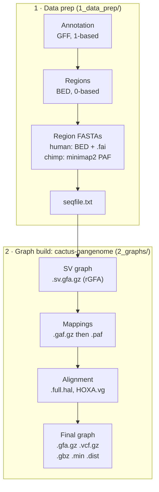

# Pipeline file types: reference

Every file the pipeline reads or writes so far: what it looks like, how it differs from similar formats, which program makes it, and which program reads it next. Examples come from the HOXA_pri build (CHM13 + chimp primary) and the Part 1 LCT benchmark, trimmed with `...`; mapping files (reads, alignments, BAMs) are left out until the mapping pipeline runs; see To do at the end.

*Last checked against real files: 2026-11-09.*

## Overview: how the files flow



Each box is a file type and each arrow is the program that turns one into the next.

## Inputs: sequence and annotation

Every file in the pipeline traces back to these five plain-text inputs.

### FASTA (`.fa`)

One header line starting with `>`, then the sequence wrapped over many lines. Region files start with samtools-style names; the build script renames them `>HOXA`.

```
>CP068271.2:27128895-27436079
GCAGAAAGGAATCGTGATTAAAAAAAAAAAAAAAGAATCAAAGGGTAGGAGAAAGAGAGTAAGAGAAAGAGAGAGAAGGAA
...                                  (80 bp per line; 307,185 bp in all)
```

- Made by: NCBI download (`download_pilot.sh`), `samtools faidx` region extraction, the build script (header cleanup).
- Read by: anything that needs raw sequence: minimap2, cactus-pangenome, `bwa index`, read simulators.

### FASTA index (`.fai`)

A table of contents for a FASTA, so tools can jump to any region without reading the whole file. Five columns: name, length, byte offset, bases per line, bytes per line.

```
CP068271.2    160567428    1053727405    80    81        (illustrative: assemblies stay on the cluster)
```

- Made by: `samtools faidx genome.fa`. Read by: `samtools faidx` when it pulls out a region (it must sit next to its FASTA).

### GFF3 (`.gff`)

Gene annotation: nine tab-separated columns, **1-based** coordinates with both ends included.

```
NC_060931.1  BestRefSeq  gene  27228895  27231899  .  -  .  ID=gene-HOXA1;...;Name=HOXA1;...;gene_biotype=protein_coding
```

- Columns: sequence · source · feature type · start · end · score · strand · phase · attributes.
- The annotation uses RefSeq names (`NC_...`); `nc_to_cp.tsv` translates them to the GenBank names (`CP...`) the FASTAs use.
- Made by: NCBI. Read by: `define_regions.sh`, which finds the anchor genes for each region.

### BED (`.bed`)

Intervals, **0-based and end-exclusive**: the start is one less than the 1-based coordinate, the end is the same. At least three columns; mine adds a name.

```
CP068274.2    147088084    147558090    GYP
CP068271.2    27128894     27436079     HOXA
CP068276.2    136128324    136420862    LCT
CP068272.2    29431787     33114927     MHC
```

- Made by: `define_regions.sh` (`regions_chm13.bed`). Read by: region extraction, bedtools, IGV.

### seqfile (`seqfile.txt`)

Cactus's input list: sample name, then FASTA path. The name sets the haplotype: no dot means haplotype 0 (the reference); `PTR.1` means sample PTR, haplotype 1.

```
CHM13 /home/pangenome/apes/graphs/HOXA_pri/HOXA_chm13.fa
PTR.1 /home/pangenome/apes/graphs/HOXA_pri/HOXA_ptr_pri.fa
```

- Made by: the build script. Read by: `cactus-pangenome`; it also decides the path names seen later (`CHM13#0#HOXA`, `PTR#1#HOXA#0`).

## Alignment files: PAF, GAF, HAL

All three record "this stretch matches that stretch"; they differ in what the target is: a linear sequence (PAF), a path through a graph (GAF), or a whole tree of genomes (HAL).

### PAF (`.paf`)

Text, one alignment per line: 12 fixed columns, then optional tags. Coordinates are **0-based**.

```
HOXA  307185  0  307185  +  CM054440.2  174648847  32799293  33105680  301213  309478  60
```

From `query_vs_ptr_pri.paf`: the whole 307,185 bp human HOXA region lands on chimp chromosome CM054440.2, with 301,213 matching bases over a 309,478 bp block, MAPQ 60.

| Columns | Meaning |
| --- | --- |
| 1–4 | query name, length, start, end |
| 5 | strand (`+` or `-`) |
| 6–9 | target name, length, start, end |
| 10 | number of matching bases |
| 11 | alignment block length (matches + mismatches + gaps) |
| 12 | mapping quality, 0–60 |

- The GYP query shows why parsing matters: two primary hits on CM054437.2 (split around the extra copy) plus a weak MAPQ 1 hit on CM054444.2. `parse_paf.py` keeps the best-supported locus.
- The Cactus PAF (`out/HOXA_pri.paf`, 16 lines) has the same columns, but each target is one minigraph node, so the base aligner can read graph mappings as ordinary pairwise alignments:

```
id=CHM13|HOXA  307185  1  51036  +  id=_MINIGRAPH_|s1  51036  1  51036  51035  51035  60
```

### GAF (`.gaf.gz`)

The graph version of PAF: the same 12 columns, but column 6 is a **path of nodes** (`>` = forward, `<` = reverse) and columns 7–9 are measured along that path.

```
id=PTR.1|HOXA  306387  1  306334  +  >id=CHM13|HOXA:0-51036>id=CHM13|HOXA:53190-78082>id=PTR.1|HOXA:75950-75963>...>id=CHM13|HOXA:290783-307185  306369  1  306316  302674  307118  60
```

- Each step names a minigraph node by where it sits on its source sequence (`id=CHM13|HOXA:0-51036` = node s1, the first 51,036 bp of CHM13). Steps on `id=PTR.1|...` are chimp-only nodes.
- The HOXA_pri GAF has just 2 lines, one per genome. PTR's path detours through three chimp-only nodes (13, 34 and 1,502 bp).
- Made by: `cactus-graphmap` (minigraph maps each whole genome region onto the SV graph). Read by: Cactus, which splits it into the per-node `.paf`.

### HAL (`.full.hal`, `chrom-alignments/HOXA.hal`)

Binary (HDF5) multiple-genome alignment. It stores every genome's full sequence plus which bases align to which, arranged on a tree: CHM13, PTR.1 and `_MINIGRAPH_` as leaves, joined by an ancestor genome.

- No text form to `head`; inspect with `halStats HOXA_pri.full.hal` (genomes and lengths) in the container.
- Made by: `cactus-align`. Read by: `hal2vg` (builds the graph), `halLiftover` (converts coordinates between genomes: the tool for translating simulated-read truth positions), `hal2maf`.

## Graph files: rGFA, GFA, VG, OG, snarls

GFA is the human-readable form of a graph; `.vg` and `.og` hold the same kind of graph in binary for vg and odgi; `.snarls` lists its bubbles.

### rGFA (`.sv.gfa.gz`): minigraph's SV graph

GFA with tags recording where each node came from, and **no genome paths**. Only variants of 50 bp or more, so it has few bubbles: the coarse view for BandageNG.

```
S  s1  GCAGAAAGGA...  LN:i:51036   SN:Z:CHM13#0#HOXA  SO:i:0      SR:i:0
S  s2  AAAGACAGAA...  LN:i:2154    SN:Z:CHM13#0#HOXA  SO:i:51036  SR:i:0
S  s3  AAAGACAGAA...  LN:i:24892   SN:Z:CHM13#0#HOXA  SO:i:53190  SR:i:0
...
S  s9  CACATA...      LN:i:13      SN:Z:PTR.1#1#HOXA  SO:i:75950  SR:i:1
L  s1  +  s2  +  0M  SR:i:0  L1:i:51036  L2:i:2154
L  s1  +  s3  +  0M  SR:i:1  L1:i:51036  L2:i:24892
L  s2  +  s3  +  0M  SR:i:0  L1:i:2154   L2:i:24892
```

- `SN` = the sequence the node came from, `SO` = its offset there, `SR` = rank (0 = CHM13 backbone, 1 = added by PTR.1). `L1`/`L2` on edges are the two nodes' lengths.
- The whole HOXA_pri SV graph is 11 nodes and 14 edges: 8 CHM13 backbone pieces plus 3 chimp-only nodes (13, 34 and 1,502 bp).
- The `s1 → s3` edge (rank 1) skips s2: chimp lacks those 2,154 bp of CHM13, a deletion bubble.
- Made by: `cactus-minigraph`. Read by: `cactus-graphmap`, BandageNG.

### GFA 1.1 (`.gfa.gz`): the final graph

Text, one record per line; the first letter is the record type.

```
H  VN:Z:1.1  RS:Z:CHM13
S  1  GCAGAAAGGAATCGTGATTAAAA  SN:Z:CHM13#0#HOXA  SO:i:0  SR:i:0
S  2  A
S  3  AAAAAAAAAAAGAATCAAAGGG...
S  4  G  SN:Z:CHM13#0#HOXA  SO:i:278  SR:i:0
S  5  C
L  1  +  3  +  0M
L  1  +  2  +  0M
L  2  +  3  +  0M
L  3  +  4  +  0M
...
W  CHM13  0  HOXA  0  307185  >1>3>4>6>7>9>10>12...
W  PTR    1  HOXA  0  306387  >1>2>3>5>6>8>9>11...
```

| Line | Meaning |
| --- | --- |
| `H` | header: GFA version; `RS` = reference sample |
| `S` | node (segment): ID and its sequence |
| `L` | edge: node and strand, to node and strand, overlap (`0M` = none) |
| `W` | walk = one genome as a path: sample, haplotype, contig, start, end, node steps |

- Two bubbles right at the start: node 2 (`A`) is on PTR's walk only (`>1>2>3` vs CHM13's `>1>3`), a 1 bp chimp insertion. Nodes 4 (`G`, CHM13) and 5 (`C`, PTR) are a SNP. These are the first two lines of the VCF.
- Some CHM13 nodes still carry the `SN`/`SO`/`SR` tags from the rGFA, recording their position on CHM13.
- HOXA_pri: 9,130 `S` lines, 12,289 `L` lines, 2 `W` lines (CHM13 307,185 bp, PTR 306,387 bp). Each of the 3,160 variants is a fork like the two above.
- Made by: `cactus-graphmap-join`. Read by: BandageNG, `odgi build`, `vg convert`, awk.

### VG (`chrom-alignments/HOXA.vg`)

Binary graph straight from `hal2vg`, before normalizing and clipping. Same content as a GFA; view with `vg stats -lz HOXA.vg` or convert with `vg convert -f HOXA.vg > HOXA.gfa`.

### OG (`viz/HOXA_pri.og`)

odgi's binary graph, built by hand for `odgi viz`. Same graph as the GFA, stored for odgi's fast drawing and statistics.

### Snarls (`.snarls`)

Binary list of the graph's bubbles ("snarls") and how they nest inside each other. `vg deconstruct` walks them to write the VCF, and `vg call` uses them to genotype. View with `vg view -R HOXA_pri.snarls | head -n 3`.

## Giraffe indexes: GBZ, MIN, DIST

Giraffe needs all three together (`-Z`, `-m`, `-d`). All are binary and built from the same graph, so they must come from the same build.

| File | Holds | Giraffe uses it to | Built by |
| --- | --- | --- | --- |
| `.gbz` | node sequences + haplotype paths (GBWT), compressed | extend seeds along stored haplotypes | `cactus-graphmap-join` |
| `.min` | minimizers (short k-mers, default k = 29) found on those haplotypes, each with its graph position | find seeds for each read | `vg minimizer` |
| `.dist` | distances between parts of the graph (snarl tree) | group nearby seeds into clusters | `vg index -j` |

- Paths in the HOXA_pri GBZ: `CHM13#0#HOXA` (reference; `vg surject` uses it for BAM coordinates) and `PTR#1#HOXA#0` (haplotype).
- The GBZ is also a complete graph file: most vg commands accept it in place of a `.vg`, and `vg convert -f HOXA_pri.gbz` turns it back into GFA.
- `.min` and `.dist` have no readable form; they are used, not looked at.

Sizes in the HOXA_pri build: `.gbz` 213 KB, `.dist` 274 KB, `.min` 4.3 MB. The minimizer index is the largest file in `out/`.

## Variant files: VCF and its index

The VCF lists the graph's bubbles as variants against CHM13: the same information as the forks in the GFA, in the format variant tools read.

```
##fileformat=VCFv4.2
##INFO=<ID=LV,Number=1,Type=Integer,Description="Level in the snarl tree (0=top level)">
##INFO=<ID=AT,Number=R,Type=String,Description="Allele Traversal as path in graph">
##contig=<ID=HOXA,length=307185>
#CHROM  POS  ID     REF  ALT  QUAL  FILTER  INFO                                        FORMAT  PTR
HOXA    23   >1>3   A    AA   60    .       AC=1;AF=1;AN=1;AT=>1>3,>1>2>3;NS=1;LV=0     GT      1
HOXA    279  >3>6   G    C    60    .       AC=1;AF=1;AN=1;AT=>3>4>6,>3>5>6;NS=1;LV=0   GT      1
HOXA    522  >6>9   T    C    60    .       AC=1;AF=1;AN=1;AT=>6>7>9,>6>8>9;NS=1;LV=0   GT      1
```

- `POS` is 1-based on CHM13. `ID` names the bubble by its start and end nodes. `AT` lists each allele's path through it, reference first.
- Line 1 is the GFA's node-2 insertion (`>1>3` vs `>1>2>3`, so `A` becomes `AA`); line 2 is the node 4/5 SNP.
- `GT` = `1` means PTR carries the ALT allele (one haplotype, so one number).
- `CHROM` is `HOXA` (not `CHM13#0#HOXA`), so BAMs need a reference named `HOXA` for variant calling to line up.

| File | What's in it |
| --- | --- |
| `.raw.vcf.gz` | straight from `vg deconstruct`: includes nested sites (`LV` of 1 or more: a variant inside a larger variant) and very large sites |
| `.vcf.gz` | after `vcfbub`: nested sites flattened to the top level and sites over 100 kb dropped; the one to use |
| `.tbi` | tabix index (binary): lets bcftools or IGV jump to a region without reading the whole file |

In HOXA_pri the raw and final VCFs are identical: 3,160 records, all `LV=0`, same file size. With two closely related haplotypes there were no nested or over-100 kb sites for `vcfbub` to change; expect a difference at MHC and GYP. Both are bgzip-compressed text that `bcftools view` or `zcat` can read.

## All file types side by side

Sorted in pipeline order. "Coordinates" is what a position in the file means; mixing 0-based and 1-based files is the most common off-by-one source.

| File | Form | Coordinates | Made by | Read by |
| --- | --- | --- | --- | --- |
| FASTA `.fa` | text | none (raw sequence) | NCBI, `samtools faidx` | minimap2, Cactus, `bwa index`, simulators |
| `.fai` | text | byte offsets | `samtools faidx` | `samtools faidx` |
| GFF3 `.gff` | text | 1-based, inclusive | NCBI | `define_regions.sh` |
| BED `.bed` | text | 0-based, end-exclusive | `define_regions.sh` | region extraction, bedtools, IGV |
| `seqfile.txt` | text | none | build script | `cactus-pangenome` |
| PAF `.paf` | text | 0-based | minimap2, `cactus-graphmap` | `parse_paf.py`, `cactus-align` |
| GAF `.gaf` | text | 0-based, along a node path | `cactus-graphmap` | Cactus |
| HAL `.hal` | binary | each genome's own | `cactus-align` | `hal2vg`, `halLiftover`, `halStats` |
| rGFA `.sv.gfa.gz` | text | nodes, with source offsets | `cactus-minigraph` | `cactus-graphmap`, BandageNG |
| GFA `.gfa.gz` | text | nodes + walks | `cactus-graphmap-join` | BandageNG, odgi, vg |
| `.vg` | binary | nodes | `hal2vg` | vg |
| `.og` | binary | nodes | `odgi build` | `odgi viz`, `odgi stats` |
| `.snarls` | binary | node pairs | Cactus (vg) | `vg deconstruct`, `vg call` |
| `.gbz` | binary | nodes + paths | `cactus-graphmap-join` | `vg giraffe`, `vg surject`, most vg |
| `.min` | binary | graph positions | `vg minimizer` | `vg giraffe` |
| `.dist` | binary | graph distances | `vg index -j` | `vg giraffe`, `vg minimizer` |
| VCF `.vcf.gz` | compressed text | 1-based on CHM13 | `vg deconstruct`, `vcfbub` | bcftools, IGV |
| `.tbi` | binary | none | tabix | bcftools, IGV |

## Quick commands to look at each file

Text files open with standard tools anywhere; graph and HAL tools run inside the container on a compute node. On a Mac use `gunzip -c` where this says `zcat`.

```
SIF=~/pangenome/containers/cactus_v2.9.9.sif     # then prefix: apptainer exec $SIF <command>
```

| File | Look at it with |
| --- | --- |
| FASTA | `grep '>' x.fa` · `head -c 400 x.fa` |
| `.fai` | `cat x.fa.fai` |
| GFF3 | `grep -v '^#' chm13_genes.gff \| head -3 \| less -S` |
| BED | `cat regions_chm13.bed` |
| PAF | `cut -f1-12 x.paf \| head` |
| GAF | `zcat x.gaf.gz \| cut -f1-12 \| head` |
| HAL | `halStats x.hal` (container) |
| rGFA / GFA | `zcat x.gfa.gz \| cut -c1-120 \| head` · record counts: `zcat x.gfa.gz \| cut -f1 \| sort \| uniq -c` |
| `.vg` / `.gbz` | `vg stats -lz x.gbz` · `vg paths -L -x x.gbz` (container) |
| `.og` | `odgi stats -i x.og -S` (container; check `odgi stats --help`) |
| `.snarls` | `vg view -R x.snarls \| head -n 3` (container) |
| `.min`, `.dist` | no viewer; check they load by running giraffe |
| VCF | `bcftools view -H x.vcf.gz \| head` · `bcftools stats x.vcf.gz \| grep ^SN` |

## To do: mapping files (once `3_mapping/` runs)

- [ ] Add the mapping stage to the overview flowchart
- [ ] FASTQ: simulated reads from the held-out haplotype (note read naming and whether truth positions are kept)
- [ ] bwa index set (`.amb .ann .bwt .pac .sa`) for the CHM13 and ptr_pri regions
- [ ] GAM: giraffe output
- [ ] GAF for reads
- [ ] SAM/BAM + `.bai`: check that reference names line up
- [ ] flagstat (and any MAPQ / placement-accuracy summaries) from the HOXA run
- [ ] Add rows for each to the side-by-side table and the quick-commands table
