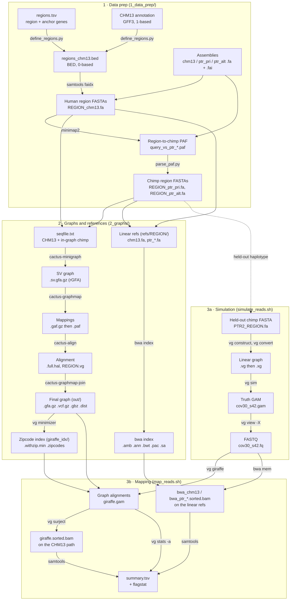

# Pipeline file types: reference

Every file the pipeline reads or writes: what it looks like, how it differs from similar formats, which program makes it, and which program reads it next. Examples come from the HOXA `pri` run (graph CHM13 + PTR.1, 30x reads simulated from PTR.2) and the Part 1 LCT benchmark, trimmed with `...`.

*Last checked against real files: 2026-11-13.*

## Overview: how the files flow



Each box is a file type and each arrow label is the program that makes the next one. For direction `pri`, the in-graph chimp is PTR.1 (ptr_pri) and the held-out one is PTR.2 (ptr_alt); `alt` swaps them.

## Inputs: sequence, annotation, region list

Every file in the pipeline traces back to these plain-text inputs.

### FASTA (`.fa`)

One header line starting with `>`, then the sequence wrapped over many lines. Region files start with samtools-style names; later steps give them short headers.

```
>CP068271.2:27128895-27436079
GCAGAAAGGAATCGTGATTAAAAAAAAAAAAAAAGAATCAAAGGGTAGGAGAAAGAGAGTAAGAGAAAGAGAGAGAAGGAA
...                                  (80 bp per line; 307,185 bp in all)
```

| Copy | Header | Made by | Used for |
| --- | --- | --- | --- |
| `regions/HOXA_chm13.fa`, `HOXA_ptr_pri.fa`, `HOXA_ptr_alt.fa` | `>CP068271.2:27128895-27436079` etc. | `define_regions.sh`, `parse_paf.py` (samtools faidx) | source for everything below |
| `graphs/HOXA_pri/HOXA_chm13.fa`, `HOXA_ptr_pri.fa` | `>HOXA` | `build_graph.sh` | Cactus input |
| `refs/HOXA/chm13.fa`, `ptr_pri.fa` | `>HOXA`, `>PTR1_HOXA` | `index_linear_refs.sh` | bwa references |
| `reads/HOXA_ptr_alt/PTR2_HOXA.fa` | `>PTR2_HOXA` | `simulate_reads.sh` | read source |

### FASTA index (`.fai`)

A table of contents for a FASTA, so tools can jump to any region without reading the whole file. Five columns: name, length, byte offset, bases per line, bytes per line.

```
CP068271.2    160567428    1053727405    80    81        (illustrative: assemblies stay on the cluster)
```

- Made by: `samtools faidx genome.fa` (vg also makes one for `PTR2_HOXA.fa` when it builds the read-source graph). Read by: `samtools faidx`; `define_regions.py` reads the assembly's `.fai` for chromosome names and lengths.

### GFF3 (`.gff`)

Gene annotation: nine tab-separated columns, **1-based** coordinates with both ends included.

```
NC_060931.1  BestRefSeq  gene  27228895  27231899  .  -  .  ID=gene-HOXA1;...;Name=HOXA1;...;gene_biotype=protein_coding
```

- Columns: sequence · source · feature type · start · end · score · strand · phase · attributes.
- The annotation uses RefSeq names (`NC_...`); `define_regions.py` matches them to the GenBank names (`CP...`) by chromosome length and writes `nc_to_cp.tsv` (24 pairs; the mitochondrion has no RefSeq row).
- Made by: NCBI. Read by: `define_regions.py`, which also writes the gene-only subset `chm13_genes.gff` and the anchor table `gene_hits.tsv`.

### Region list (`regions.tsv`)

The single list of study regions, in the repo root. Tab-separated: region name, comma-separated anchor genes, note; `#` lines are comments.

```
GYP	GYPA,GYPB,GYPE	glycophorin cluster (segmental duplications)
HOXA	HOXA1,HOXA13	whole HOXA cluster (easy control)
LCT	MCM6,LCT	LCT gene + MCM6, which holds the lactase enhancer
MHC	MOG,COL11A2	classical MHC boundaries (class I through class II)
```

- Read by: `define_regions.py` (gene lookup) and `align_regions_py.sh` (which regions to align). Adding a line adds a region.

### BED (`.bed`)

Intervals, **0-based and end-exclusive**: the start is one less than the 1-based coordinate, the end is the same. Ours have a fourth column, the region name.

```
CP068274.2    147088084    147558090    GYP
CP068271.2    27128894     27436079     HOXA
CP068276.2    136128324    136420862    LCT
CP068272.2    29431787     33114927     MHC
```

- Made by: `define_regions.py` (`regions_chm13.bed`): leftmost anchor start to rightmost anchor end, plus 100 kb each side. Read by: region extraction in `define_regions.sh`, bedtools, IGV.

### seqfile (`seqfile.txt`)

Cactus's input list: sample name, then FASTA path. The name sets the haplotype: no dot means haplotype 0 (the reference); `PTR.1` means sample PTR, haplotype 1.

```
CHM13 /home/jad33864/pangenome/apes/graphs/HOXA_pri/HOXA_chm13.fa
PTR.1 /home/jad33864/pangenome/apes/graphs/HOXA_pri/HOXA_ptr_pri.fa
```

- Made by: `build_graph.sh` (`PTR.2` for direction `alt`). Read by: `cactus-pangenome`; it decides the path names seen later (`CHM13#0#HOXA`, `PTR#1#HOXA#0`).

## Alignment files: PAF, GAF, HAL

All three record "this stretch matches that stretch"; they differ in what the target is: a linear sequence (PAF), a path through a graph (GAF), or a whole tree of genomes (HAL).

### PAF (`.paf`)

Text, one alignment per line: 12 fixed columns, then optional tags. Coordinates are **0-based**.

```
HOXA  307185  0  307185  +  CM054440.2  174648847  32799293  33105680  301213  309478  60
```

From `query_vs_ptr_pri.paf`: the whole 307,185 bp human HOXA region lands on chimp chromosome CM054440.2, with 301,213 matching bases over a 309,478 bp block, MAPQ 60.

| Columns | Meaning |
| --- | --- |
| 1–4 | query name, length, start, end |
| 5 | strand (`+` or `-`) |
| 6–9 | target name, length, start, end |
| 10 | number of matching bases |
| 11 | alignment block length (matches + mismatches + gaps) |
| 12 | mapping quality, 0–60 |

- The GYP query shows why parsing matters: two primary hits on CM054437.2 (split around the extra copy) plus a weak MAPQ 1 hit on CM054444.2. `parse_paf.py` keeps the best-supported locus.
- The Cactus PAF (`out/HOXA_pri.paf`, 16 lines) has the same columns, but each target is one minigraph node, so the base aligner can read graph mappings as ordinary pairwise alignments:

```
id=CHM13|HOXA  307185  1  51036  +  id=_MINIGRAPH_|s1  51036  1  51036  51035  51035  60
```

### GAF (`.gaf.gz`)

The graph version of PAF: the same 12 columns, but column 6 is a **path of nodes** (`>` = forward, `<` = reverse) and columns 7–9 are measured along that path.

```
id=PTR.1|HOXA  306387  1  306334  +  >id=CHM13|HOXA:0-51036>id=CHM13|HOXA:53190-78082>id=PTR.1|HOXA:75950-75963>...>id=CHM13|HOXA:290783-307185  306369  1  306316  302674  307118  60
```

- Each step names a minigraph node by where it sits on its source sequence (`id=CHM13|HOXA:0-51036` = node s1, the first 51,036 bp of CHM13). Steps on `id=PTR.1|...` are chimp-only nodes.
- The HOXA_pri GAF has just 2 lines, one per genome. PTR's path detours through three chimp-only nodes (13, 34 and 1,502 bp).
- Made by: `cactus-graphmap`. Read by: Cactus, which splits it into the per-node `.paf`. (Giraffe can also write read alignments as GAF; this pipeline uses GAM.)

### HAL (`.full.hal`, `chrom-alignments/HOXA.hal`)

Binary (HDF5) multiple-genome alignment. It stores every genome's full sequence plus which bases align to which, arranged on a tree: CHM13, PTR.1 and `_MINIGRAPH_` as leaves, joined by an ancestor genome.

- No text form to `head`; inspect with `halStats HOXA_pri.full.hal` in the container.
- Made by: `cactus-align`. Read by: `hal2vg` (builds the graph), `halLiftover` (converts coordinates between genomes: the planned tool for translating simulated reads' true positions), `hal2maf`.

## Graph files: rGFA, GFA, VG, XG, OG, snarls

GFA is the human-readable form of a graph; `.vg`, `.xg` and `.og` hold graphs in binary for vg and odgi; `.snarls` lists a graph's bubbles.

### rGFA (`.sv.gfa.gz`): minigraph's SV graph

GFA with tags recording where each node came from, and **no genome paths**. Only variants of 50 bp or more, so it has few bubbles: the coarse view for BandageNG.

```
S  s1  GCAGAAAGGA...  LN:i:51036   SN:Z:CHM13#0#HOXA  SO:i:0      SR:i:0
S  s2  AAAGACAGAA...  LN:i:2154    SN:Z:CHM13#0#HOXA  SO:i:51036  SR:i:0
S  s3  AAAGACAGAA...  LN:i:24892   SN:Z:CHM13#0#HOXA  SO:i:53190  SR:i:0
...
S  s9  CACATA...      LN:i:13      SN:Z:PTR.1#1#HOXA  SO:i:75950  SR:i:1
L  s1  +  s2  +  0M  SR:i:0  L1:i:51036  L2:i:2154
L  s1  +  s3  +  0M  SR:i:1  L1:i:51036  L2:i:24892
L  s2  +  s3  +  0M  SR:i:0  L1:i:2154   L2:i:24892
```

- `SN` = the sequence the node came from, `SO` = its offset there, `SR` = rank (0 = CHM13 backbone, 1 = added by PTR.1). `L1`/`L2` on edges are the two nodes' lengths.
- The whole HOXA_pri SV graph is 11 nodes and 14 edges: 8 CHM13 backbone pieces plus 3 chimp-only nodes (13, 34 and 1,502 bp).
- The `s1 → s3` edge (rank 1) skips s2: chimp lacks those 2,154 bp of CHM13, a deletion bubble.
- Made by: `cactus-minigraph`. Read by: `cactus-graphmap`, BandageNG.

### GFA 1.1 (`.gfa.gz`): the final graph

Text, one record per line; the first letter is the record type.

```
H  VN:Z:1.1  RS:Z:CHM13
S  1  GCAGAAAGGAATCGTGATTAAAA  SN:Z:CHM13#0#HOXA  SO:i:0  SR:i:0
S  2  A
S  3  AAAAAAAAAAAGAATCAAAGGG...
S  4  G  SN:Z:CHM13#0#HOXA  SO:i:278  SR:i:0
S  5  C
L  1  +  3  +  0M
L  1  +  2  +  0M
L  2  +  3  +  0M
L  3  +  4  +  0M
...
W  CHM13  0  HOXA  0  307185  >1>3>4>6>7>9>10>12...
W  PTR    1  HOXA  0  306387  >1>2>3>5>6>8>9>11...
```

| Line | Meaning |
| --- | --- |
| `H` | header: GFA version; `RS` = reference sample |
| `S` | node (segment): ID and its sequence |
| `L` | edge: node and strand, to node and strand, overlap (`0M` = none) |
| `W` | walk = one genome as a path: sample, haplotype, contig, start, end, node steps |

- Two bubbles right at the start: node 2 (`A`) is on PTR's walk only (`>1>2>3` vs CHM13's `>1>3`), a 1 bp chimp insertion. Nodes 4 (`G`, CHM13) and 5 (`C`, PTR) are a SNP. These are the first two lines of the VCF.
- Some CHM13 nodes still carry the `SN`/`SO`/`SR` tags from the rGFA, recording their position on CHM13.
- HOXA_pri: 9,130 `S` lines, 12,289 `L` lines, 2 `W` lines (CHM13 307,185 bp, PTR 306,387 bp). Each of the 3,160 variants is a fork like the two above.
- Made by: `cactus-graphmap-join`. Read by: BandageNG, `odgi build`, `vg convert`, awk.

### VG (`chrom-alignments/HOXA.vg`, `reads/HOXA_ptr_alt/PTR2_HOXA.vg`)

Binary graph. Two uses here:
- `chrom-alignments/HOXA.vg`: straight from `hal2vg`, before normalizing and clipping.
- `PTR2_HOXA.vg`: a graph of one straight line (the held-out haplotype), made with `vg construct -r`, only because `vg sim` simulates from graphs.

View with `vg stats -lz FILE.vg` or convert with `vg convert -f FILE.vg > FILE.gfa`.

### XG (`reads/HOXA_ptr_alt/PTR2_HOXA.xg`)

A read-only, indexed form of a graph that can answer "what is at position N on this path?" quickly. `vg sim` needs that to record each simulated read's true position. Made by `vg convert -x` from the `.vg`; read by `vg sim`. 456 KB for the 306 kb HOXA PTR.2 line.

### OG (`viz/HOXA_pri.og`)

odgi's binary graph, built by hand for `odgi viz`. Same graph as the GFA, stored for odgi's fast drawing and statistics.

### Snarls (`.snarls`)

Binary list of the graph's bubbles ("snarls") and how they nest inside each other. `vg deconstruct` walks them to write the VCF, and `vg call` uses them to genotype. View with `vg view -R HOXA_pri.snarls | head -n 3`.

## Giraffe indexes: GBZ, minimizers, distance index

Giraffe needs three files together: the graph (`-Z`), a minimizer index (`-m`, plus `-z` for its zipcodes) and the distance index (`-d`). All are binary and must come from the same graph build.

| File | Holds | Giraffe uses it to | Built by |
| --- | --- | --- | --- |
| `out/HOXA_pri.gbz` | node sequences + haplotype paths (GBWT), compressed | extend seeds along stored haplotypes | `cactus-graphmap-join` |
| `out/HOXA_pri.dist` | distances between parts of the graph (snarl tree) | group nearby seeds into clusters | `cactus-graphmap-join` (`vg index -j`) |
| `out/HOXA_pri.min` | minimizers on the haplotypes, with graph positions, **no zipcodes** | not used: this vg wants zipcodes | `cactus-graphmap-join` |
| `giraffe_idx/HOXA_pri.withzip.min` + `HOXA_pri.zipcodes` | minimizers (k = 29, w = 11) annotated with zipcodes (each seed's place in the distance index) | find seeds and cluster them quickly | `build_graph.sh` (`vg minimizer -d DIST -z ZIP -o ZMIN GBZ`) |

- Paths in the HOXA_pri GBZ: `CHM13#0#HOXA` (reference; `vg surject` uses it for BAM coordinates) and `PTR#1#HOXA#0` (haplotype).
- If Giraffe gets a minimizer index without zipcodes, it prints "Rebuilding minimizer index to include zipcodes" and writes `*.shortread.withzip.min` / `*.shortread.zipcodes` next to the GBZ, inside `out/`. That's why `build_graph.sh` makes them in `giraffe_idx/` and `map_reads.sh` passes them with `-m` and `-z`.
- The GBZ is also a complete graph file: most vg commands accept it in place of a `.vg`, and `vg convert -f HOXA_pri.gbz` turns it back into GFA.
- Sizes in HOXA_pri: `.gbz` 213 KB, `.dist` 274 KB, `.withzip.min` 4.3 MB, `.zipcodes` 24 KB.

## Variant files: VCF and its index

The VCF lists the graph's bubbles as variants against CHM13: the same information as the forks in the GFA, in the format variant tools read.

```
##fileformat=VCFv4.2
##INFO=<ID=LV,Number=1,Type=Integer,Description="Level in the snarl tree (0=top level)">
##INFO=<ID=AT,Number=R,Type=String,Description="Allele Traversal as path in graph">
##contig=<ID=HOXA,length=307185>
#CHROM  POS  ID     REF  ALT  QUAL  FILTER  INFO                                        FORMAT  PTR
HOXA    23   >1>3   A    AA   60    .       AC=1;AF=1;AN=1;AT=>1>3,>1>2>3;NS=1;LV=0     GT      1
HOXA    279  >3>6   G    C    60    .       AC=1;AF=1;AN=1;AT=>3>4>6,>3>5>6;NS=1;LV=0   GT      1
HOXA    522  >6>9   T    C    60    .       AC=1;AF=1;AN=1;AT=>6>7>9,>6>8>9;NS=1;LV=0   GT      1
```

- `POS` is 1-based on CHM13. `ID` names the bubble by its start and end nodes. `AT` lists each allele's path through it, reference first.
- Line 1 is the GFA's node-2 insertion (`>1>3` vs `>1>2>3`, so `A` becomes `AA`); line 2 is the node 4/5 SNP.
- `GT` = `1` means PTR carries the ALT allele (one haplotype, so one number).
- `CHROM` is `HOXA`. The bwa→CHM13 BAM also calls its reference `HOXA`, but the Giraffe BAM calls it `CHM13#0#HOXA`; rename one before calling variants from Giraffe alignments.

| File | What's in it |
| --- | --- |
| `.raw.vcf.gz` | straight from `vg deconstruct`: includes nested sites (`LV` of 1 or more: a variant inside a larger variant) and very large sites |
| `.vcf.gz` | after `vcfbub`: nested sites flattened to the top level and sites over 100 kb dropped; the one to use |
| `.tbi` | tabix index (binary): lets bcftools or IGV jump to a region without reading the whole file |

In HOXA_pri the raw and final VCFs are identical: 3,160 records, all `LV=0`, same file size. With two closely related haplotypes there were no nested or over-100 kb sites for `vcfbub` to change; expect a difference at MHC and GYP. Both are bgzip-compressed text that `bcftools view` or `zcat` can read.

## Linear references: FASTA + bwa index

`index_linear_refs.sh` writes the two linear references bwa maps to, into `refs/REGION/`, and indexes each one:

| Reference | Header | Length (HOXA) | Stands for |
| --- | --- | --- | --- |
| `chm13.fa` | `>HOXA` (matches the graph VCF) | 307,185 bp | the "just use human" option |
| `ptr_pri.fa` (or `ptr_alt.fa` for `alt`) | `>PTR1_HOXA` (or `>PTR2_HOXA`) | 306,387 bp | same-species best case |

### bwa index set (`.amb .ann .bwt .pac .sa`)

Five binary files made by `bwa index ref.fa`, always used together; bwa finds them by the FASTA's name.

| File | Holds | HOXA chm13 size |
| --- | --- | --- |
| `.bwt` | Burrows-Wheeler transform of the sequence: fast exact matching | 307 KB |
| `.sa` | suffix array samples: turn a match into a position | 154 KB |
| `.pac` | the sequence packed at 2 bits per base | 77 KB |
| `.ann` | sequence names and lengths | 37 B |
| `.amb` | where the `N` bases are | 11 B |

## Reads and mapping files

Reads are simulated once from the held-out haplotype and go to all three mappers. Alignments come out as GAM on the graph and BAM on linear sequences; `summary.tsv` puts the three side by side.

### Simulated-read GAM (`reads/HOXA_ptr_alt/cov30_s42.gam`)

Binary (protobuf) read alignments on a graph. `vg sim -a` writes one alignment per simulated read against the `PTR2_HOXA.xg` line, so it records **where each read truly came from** on PTR.2. This is the answer key for scoring placement later. The run tag `cov30_s42` = 30x coverage, seed 42; 61,279 reads, 6.7 MB.

- Peek: `vg view -a FILE.gam | head -n 1` prints the first alignment as JSON (read name, sequence, path through node IDs, edits, score, mapping quality).

### FASTQ (`reads/HOXA_ptr_alt/cov30_s42.fq`)

Four lines per read: name, sequence, `+`, and one quality character per base. Made from the truth GAM with `vg view -X`, so every mapper gets identical reads.

```
@d5430b6805da973a
CAGGCTAGACAAGGTTGGCTTCAATTTTATCTGGGATGAGTCACTGGGTCTGAGCATATCTTTCTGAGCCAGTATACCTGTCATGGAGAATTGTCATGGG...
+
????????????????????????????????????????????????????????????????????????????????????????????????????...
```

- `vg sim` names reads with random IDs and gives every base the same placeholder quality (`?`). The settings (150 bp, 1% substitution, 0.2% indel errors, single-end) live in `config.sh`.
- 19.7 MB for 61,279 reads. Read by: `vg giraffe -f`, `bwa mem`.

### Giraffe GAM (`results/HOXA_pri/cov30_s42/giraffe.gam`)

The same format as the truth GAM, but now each read's alignment **to the pangenome graph**. `vg stats -a` summarizes it into `giraffe.gam_stats.txt`:

```
Total alignments: 61279
Total aligned: 61255
Total perfect: 11540
Total gapless (softclips allowed): 52196
Mapping quality: mean 59.6852, median 60, stdev 2.66349, max 60 (60239 reads)
Insertions: 9803 bp in 9605 read events
Deletions: 1153 bp in 1102 read events
Substitutions: 93004 bp in 93004 read events
...
```

- 85% of reads (52,196) aligned without any gap: Giraffe's fast path, extending seeds straight along a stored haplotype.
- `Total aligned` (61,255) is the `giraffe_graph` row of the summary: reads placed on the graph **before** projecting to CHM13.

### SAM / BAM (`.sorted.bam`) and `.bai`

Alignments on a linear sequence: `@` header lines, then one line per read with 11 fixed columns plus tags. BAM is the compressed binary form of SAM; `.bai` indexes a sorted BAM by position. The same three reads in each of the three BAMs:

```
giraffe.sorted.bam      @SQ  SN:CHM13#0#HOXA  LN:307185
  6ca6d951b554b254  16  CHM13#0#HOXA  1  60  23M1I126M      AS:i:143
  5424f874eca38222   0  CHM13#0#HOXA  4  60  20M1I43M1I85M  AS:i:141

bwa_chm13.sorted.bam    @SQ  SN:HOXA  LN:307185
  6ca6d951b554b254  16  HOXA  1  60  25M1I124M      NM:i:2  MD:Z:127A21  AS:i:137  XS:i:0
  5424f874eca38222   0  HOXA  4  60  28M1I35M1I85M  NM:i:2  MD:Z:148     AS:i:134  XS:i:19

bwa_ptr_pri.sorted.bam  @SQ  SN:PTR1_HOXA  LN:306387
  6ca6d951b554b254  16  PTR1_HOXA  1  60  150M      NM:i:2  MD:Z:25A102A21  AS:i:140  XS:i:0
  5424f874eca38222   0  PTR1_HOXA  4  60  64M1I85M  NM:i:2  MD:Z:28A120     AS:i:137  XS:i:0
```

(columns shown: name, FLAG, reference, position, MAPQ, CIGAR, tags; sequence and qualities left out)

| Column | Meaning |
| --- | --- |
| 1 QNAME | read name |
| 2 FLAG | bit flags: 4 = unmapped, 16 = reverse strand, 256 = secondary, 2048 = supplementary |
| 3 RNAME | reference sequence name |
| 4 POS | 1-based leftmost position |
| 5 MAPQ | confidence: 0 = could be anywhere, 60 = unique |
| 6 CIGAR | how the read lines up: `M` aligned, `I` inserted in the read, `D` deleted from it |
| 7–9 | mate's reference, mate's position, insert size |
| 10–11 | sequence, base qualities |

| Tag | Meaning | Written by |
| --- | --- | --- |
| `AS` | alignment score | all three |
| `NM` | edit distance to the reference (mismatches + indel bases) | bwa only |
| `MD` | where the mismatches are, e.g. `127A21` = 127 matches, reference `A` mismatched, 21 matches | bwa only |
| `XS` | score of the best other placement (high = a near-tie elsewhere) | bwa only |

- The reference name follows its source: surject uses the graph path name (`CHM13#0#HOXA`), bwa uses the FASTA header (`HOXA`, `PTR1_HOXA`).
- The first read lines up end to end against PTR.1 (`150M`, 2 mismatches) but needs an insertion against CHM13 (`25M1I124M`): the reference's distance from the reads shows up directly in the CIGAR.
- Giraffe and bwa can place the same indel at slightly different spots (`23M1I...` vs `25M1I...`) when the sequence around it repeats; both are valid alignments.
- `@PG` header lines record each program that touched the file and its exact command.
- Made by: `vg surject -b` (Giraffe) or `bwa mem`, then `samtools sort` and `samtools index`. 2.2–2.9 MB each at 30x.

### flagstat (`.flagstat.txt`)

Plain-text counts from `samtools flagstat`, one file per BAM. For `bwa_chm13`:

```
61400 + 0 in total (QC-passed reads + QC-failed reads)
61279 + 0 primary
0 + 0 secondary
121 + 0 supplementary
...
61316 + 0 mapped (99.86% : N/A)
61195 + 0 primary mapped (99.86% : N/A)
```

- "In total" counts BAM lines, not reads: the 121 supplementary lines are reads bwa split into two pieces aligned to different places. Use "primary" (one line per read), as `summary.tsv` does.

### Summary (`summary.tsv`)

One row per method, built by `map_reads.sh` from the BAMs (counting each read once, via `samtools view -F 0x900`) and from the Giraffe GAM stats:

```
method         reads  mapped  pct_mapped  mapq0  mapq1_29  mapq30_59  mapq60
giraffe        61279  60980   99.51       0      14        1001       59965
bwa_chm13      61279  61195   99.86       62     450       806        59877
bwa_ptr_pri    61279  61279   100.00      0      65        412        60802
giraffe_graph  61279  61255   99.96       NA     NA        NA         NA
```

- `giraffe_graph` = placed on the graph (from the GAM); `giraffe` = after `vg surject` onto CHM13. The gap (275 reads) is most likely reads aligned to chimp-only sequence, which has no CHM13 position (not yet checked read by read).
- MAPQ is calculated differently by Giraffe and bwa, so compare MAPQ columns within a mapper (bwa→CHM13 vs bwa→PTR.1), not across mappers.

## All file types side by side

Sorted in pipeline order. "Coordinates" is what a position in the file means; mixing 0-based and 1-based files is the most common off-by-one source.

| File | Form | Coordinates | Made by | Read by |
| --- | --- | --- | --- | --- |
| FASTA `.fa` | text | none (raw sequence) | NCBI, `samtools faidx`, pipeline scripts | minimap2, Cactus, `bwa index`, `vg construct` |
| `.fai` | text | byte offsets | `samtools faidx` | `samtools faidx`, `define_regions.py` |
| GFF3 `.gff` | text | 1-based, inclusive | NCBI | `define_regions.py` |
| `regions.tsv` | text | none | you | `define_regions.py`, `align_regions_py.sh` |
| BED `.bed` | text | 0-based, end-exclusive | `define_regions.py` | region extraction, bedtools, IGV |
| `seqfile.txt` | text | none | `build_graph.sh` | `cactus-pangenome` |
| PAF `.paf` | text | 0-based | minimap2, `cactus-graphmap` | `parse_paf.py`, `cactus-align` |
| GAF `.gaf.gz` | text | 0-based, along a node path | `cactus-graphmap` | Cactus |
| HAL `.hal` | binary (HDF5) | each genome's own | `cactus-align` | `hal2vg`, `halLiftover`, `halStats` |
| rGFA `.sv.gfa.gz` | text | nodes, with source offsets | `cactus-minigraph` | `cactus-graphmap`, BandageNG |
| GFA `.gfa.gz` | text | nodes + walks | `cactus-graphmap-join` | BandageNG, odgi, vg |
| `.vg` | binary | nodes | `hal2vg`, `vg construct` | vg |
| `.xg` | binary | nodes + path positions | `vg convert -x` | `vg sim` |
| `.og` | binary | nodes | `odgi build` | `odgi viz`, `odgi stats` |
| `.snarls` | binary | node pairs | Cactus (vg) | `vg deconstruct`, `vg call` |
| `.gbz` | binary | nodes + paths | `cactus-graphmap-join` | `vg giraffe`, `vg surject`, `vg minimizer` |
| `.dist` | binary | graph distances | `cactus-graphmap-join` | `vg giraffe`, `vg minimizer` |
| `.min` (Cactus) | binary | graph positions | `cactus-graphmap-join` | nothing in this pipeline (no zipcodes) |
| `.withzip.min` + `.zipcodes` | binary | graph positions + zipcodes | `vg minimizer` (`build_graph.sh`) | `vg giraffe` |
| VCF `.vcf.gz` | compressed text | 1-based on CHM13 | `vg deconstruct`, `vcfbub` | bcftools, IGV |
| `.tbi` | binary | none | tabix | bcftools, IGV |
| bwa index | binary | linear | `bwa index` | `bwa mem` |
| GAM `.gam` | binary | nodes | `vg sim` (truth), `vg giraffe` | `vg view`, `vg surject`, `vg stats` |
| FASTQ `.fq` | text | none | `vg view -X` | `vg giraffe`, `bwa mem` |
| SAM/BAM `.bam` | binary | 1-based | `bwa mem`, `vg surject` + samtools | samtools, IGV |
| `.bai` | binary | none | `samtools index` | samtools, IGV |
| flagstat `.txt` | text | none | `samtools flagstat` | you |
| `giraffe.gam_stats.txt` | text | none | `vg stats -a` | `map_reads.sh`, you |
| `summary.tsv` | text | none | `map_reads.sh` | you |

## Quick commands to look at each file

Text files open with standard tools anywhere; graph and HAL tools run inside the container on a compute node. On a Mac use `gunzip -c` where this says `zcat`.

```
SIF=~/pangenome/containers/cactus_v2.9.9.sif     # then prefix: apptainer exec $SIF <command>
```

| File | Look at it with |
| --- | --- |
| FASTA | `grep '>' x.fa` · `head -c 400 x.fa` |
| `.fai` | `cat x.fa.fai` |
| GFF3 | `grep -v '^#' chm13_genes.gff \| head -3 \| less -S` |
| `regions.tsv`, BED | `cat regions.tsv` · `cat regions_chm13.bed` |
| PAF | `cut -f1-12 x.paf \| head` |
| GAF | `zcat x.gaf.gz \| cut -f1-12 \| head` |
| HAL | `halStats x.hal` (container) |
| rGFA / GFA | `zcat x.gfa.gz \| cut -c1-120 \| head` · record counts: `zcat x.gfa.gz \| cut -f1 \| sort \| uniq -c` |
| `.vg` / `.xg` / `.gbz` | `vg stats -lz x.gbz` · `vg paths -L -x x.gbz` (container) |
| `.og` | `odgi stats -i x.og -S` (container; check `odgi stats --help`) |
| `.snarls` | `vg view -R x.snarls \| head -n 3` (container) |
| minimizer, zipcodes, `.dist`, bwa index | no viewer; check they load by running the mapper |
| VCF | `bcftools view -H x.vcf.gz \| head` · `bcftools stats x.vcf.gz \| grep ^SN` |
| FASTQ | `head -n 8 reads.fq` |
| GAM | `vg view -a x.gam \| head -n 1` · `vg stats -a x.gam` (container) |
| SAM/BAM | `samtools view -H x.bam` · `samtools view x.bam \| head -n 3 \| cut -f1-9` |
| flagstat, summary | `cat x.flagstat.txt` · `column -t summary.tsv` |

## To do

- [ ] Placement accuracy files: a truth-only CHM13 + PTR.1 + PTR.2 build, `halLiftover` output of true read positions, and the per-read correct/incorrect table
- [ ] Mismatch summary: bwa BAMs carry `NM`, but `vg surject` doesn't write it; add it with `samtools calmd` (needs a reference FASTA whose name matches `CHM13#0#HOXA`) or compute it from the GAM
- [ ] Read-level GAF, if `vg giraffe -o gaf` is ever used instead of GAM
- [ ] Paired-end examples, if `PAIRED=true` is used
- [ ] `alt`-direction examples once HOXA_alt is built (expect `PTR.2` / `PTR2_HOXA` / `ptr_alt` in place of the `pri` names)
